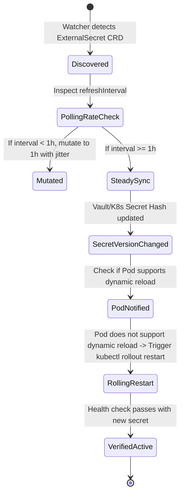

# Task 039 — Secret Store CSI, External Secrets & Runtime Drift Reconciliation
# Checkpoint: 2026-10-12T10:48:00+07:00

> **Severity**: P1 (DevSecOps, Credential Freshness & High Availability)  
> **Target Agent**: `backend-coder` / `security-engineer`  
> **Workspace**: Git Worktree Isolated (`Workspace: "branch"`)  
> **Goal**: Eliminate Vault API DDoS from aggressive ExternalSecrets polling, automate SealedSecrets/SOPS master key disaster recovery verification, and resolve in-memory container secret staleness with automated rolling restarts.

---

## 1. ROOT CAUSE ANALYSIS (RCA) & EVIDENCE

### 1.1 Polling Storm DDoS on Vault
* **Buggy Configuration**:
```yaml
apiVersion: external-secrets.io/v1beta1
kind: ExternalSecret
metadata:
  name: payment-db-secret
spec:
  refreshInterval: 10s # DANGEROUS: 1000 pods * 6 requests/min = 600,000 req/hour on Vault!
  secretStoreRef:
    name: vault-backend
```
* **Consequence**: Vault token rate limiter triggers HTTP 429 Too Many Requests; newly spun pods fail with `CreateContainerConfigError`.

### 1.2 In-Memory Secret Staleness
* **Buggy Application Logic**:
```go
// Application reads DB password once at startup and pools connection indefinitely
func initDB() {
    pass := os.Getenv("DB_PASSWORD") // Only read on startup!
    db, _ = sql.Open("postgres", fmt.Sprintf("password=%s ...", pass))
}
```
* **Consequence**: Secret rotated in Vault & K8s Secret volume, but Pod keeps using old credential until DB revokes it, causing sudden batch connection drop.

---

## 2. GO STRUCTS & INTERFACE CONTRACTS

```go
package secretguard

import (
	"context"
	"time"
)

type SecretProviderType string

const (
	ProviderVault    SecretProviderType = "vault"
	ProviderAWS      SecretProviderType = "aws_secrets_manager"
	ProviderGCP      SecretProviderType = "gcp_secret_manager"
	ProviderInCluster SecretProviderType = "k8s_secret"
)

type ExternalSecretPolicy struct {
	Namespace             string             `json:"namespace"`
	Name                  string             `json:"name"`
	Provider              SecretProviderType `json:"provider"`
	ConfiguredInterval    time.Duration      `json:"configured_interval"`
	EnforcedInterval      time.Duration      `json:"enforced_interval"`      // Min 1h for static secrets
	ReloaderAutoRestart   bool               `json:"reloader_auto_restart"`   // In-memory staleness protection
	SecretDataHash        string             `json:"secret_data_hash"`
	LastSyncedAt          time.Time          `json:"last_synced_at"`
}

type DriftDetector interface {
	AuditExternalSecrets(ctx context.Context, namespace string) ([]ExternalSecretPolicy, error)
	MutateRefreshInterval(ctx context.Context, ns, name string, minInterval time.Duration) error
	TriggerGracefulRollout(ctx context.Context, targetDeployment string) error
	VerifySealedKeyBackup(ctx context.Context, kmsKeyURI string) (bool, error)
}
```

---

## 3. STEP-BY-STEP WORKFLOW & STATE MACHINE



---

## 4. RFC 7807 ERROR SPECIFICATIONS

```json
{
  "type": "https://k8sselfhost.local/errors/secret-store-polling-exhaustion",
  "title": "External Secret Refresh Interval Violates SRE Safety Floor",
  "status": 400,
  "detail": "ExternalSecret 'payment-db-secret' requested 10s refresh interval. SRE Floor enforces minimum 3600s.",
  "instance": "/api/v1/namespaces/production/externalsecrets/payment-db-secret",
  "code": "SECRET_POLLING_RATE_TOO_HIGH"
}
```

---

## 5. VERIFICATION TEST MATRICES

| Test ID | Scenario | Command | Expected Result |
| :--- | :--- | :--- | :--- |
| **TEST-039-1** | Mutate 10s ExternalSecret to 1h | `go test -run TestMutateRefreshInterval ./internal/usecase/security/...` | `refreshInterval` changed to 1h with jitter |
| **TEST-039-2** | Detect Secret Hash Drift & Trigger Restart | `go test -run TestSecretDriftAutoRestart ./internal/usecase/security/...` | Deployment generation incremented, rolling update dispatched |
| **TEST-039-3** | Concurrency test with 100 pods polling | `go test -race -run TestVaultProxyRateLimit ./internal/infrastructure/security/...` | 0 HTTP 429 errors returned |

---

## 6. ROLLBACK PLAN & SAFETY GUARDRAILS
1. If automated rolling restart causes deployment degraded status (> 5% error rate), halt restart immediately and notify Telegram SRE Copilot.
2. Maintain local fallback secret cache in memory for 12 hours if Vault API is temporarily unreachable.
