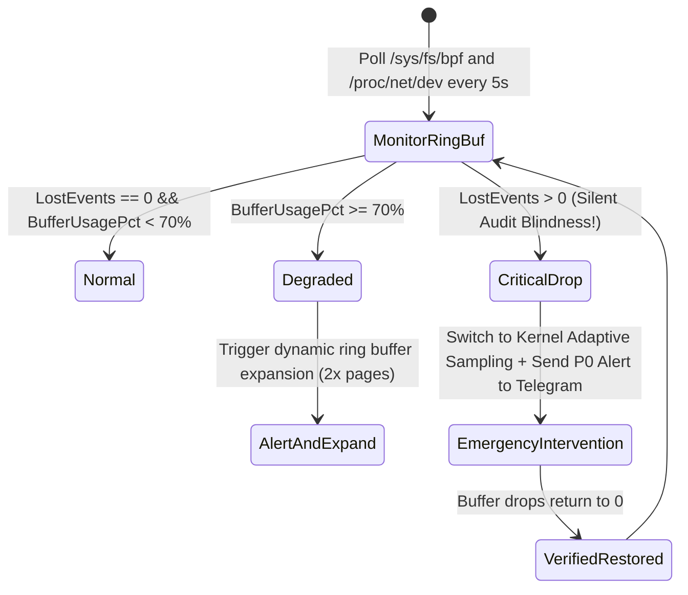

# Task 040 — eBPF Runtime Security, RingBuffer Overflow & Kernel Probe Watchdog
# Checkpoint: 2026-10-12T10:48:00+07:00

> **Severity**: P1 (DevSecOps, Kernel Stability & Security Observability)  
> **Target Agent**: `backend-coder` / `devops`  
> **Workspace**: Git Worktree Isolated (`Workspace: "branch"`)  
> **Goal**: Prevent silent security audit blindness from Tetragon/Falco RingBuffer drops, validate eBPF CO-RE compatibility against kernel minor updates, and limit tail-call CPU exhaustion.

---

## 1. ROOT CAUSE ANALYSIS (RCA) & EVIDENCE

### 1.1 Silent Audit Blindness via RingBuffer Overflow
* **Buggy Kernel/Config State**:
```c
// eBPF kernel program sends event to userspace ringbuffer
struct {
    __uint(type, BPF_MAP_TYPE_RINGBUF);
    __uint(max_entries, 256 * 1024); // 256KB too small for high-traffic node!
} events SEC(".maps");

// Under 500,000 syscalls/sec, bpf_ringbuf_reserve returns NULL:
data = bpf_ringbuf_reserve(&events, sizeof(*data), 0);
if (!data) {
    // SILENT DROP: No event logged to userspace!
    return 0;
}
```
* **Consequence**: Kernel silently drops security audit events; hacker executes cryptominer without detection.

### 1.2 Kernel Crash on Unstable Kprobe
* **Buggy Attachment**:
```go
// Direct attachment to internal, unexported kernel symbol
link, err := prog.AttachKprobe("do_exit") // Kernel 5.15 -> 6.1 changed signature!
// Causes kernel panic or soft lockup during unregistration
```

---

## 2. GO STRUCTS & INTERFACE CONTRACTS

```go
package ebpfwatch

import (
	"context"
	"time"
)

type ProbeHookType string

const (
	HookTracepoint ProbeHookType = "tracepoint"
	HookFentry     ProbeHookType = "fentry"
	HookFexit      ProbeHookType = "fexit"
	HookKprobeRaw  ProbeHookType = "kprobe_raw" // Restricted
)

type RingBufferTelemetry struct {
	ProbeName       string    `json:"probe_name"`
	TotalEvents     uint64    `json:"total_events"`
	LostEvents      uint64    `json:"lost_events"`
	BufferUsagePct  float64   `json:"buffer_usage_pct"`
	AvgProcTimeNs   uint64    `json:"avg_proc_time_ns"`
	SampleTimestamp time.Time `json:"sample_timestamp"`
}

type KernelSafetyValidator interface {
	CheckBTFSupport(ctx context.Context) (bool, error)
	AuditRingBufferPressure(ctx context.Context) ([]RingBufferTelemetry, error)
	AutoExpandRingBuffer(ctx context.Context, probe string, newPages int) error
	ValidateHookSafety(hookType ProbeHookType, symbol string) error
}
```

---

## 3. STEP-BY-STEP WORKFLOW & STATE MACHINE



---

## 4. RFC 7807 ERROR SPECIFICATIONS

```json
{
  "type": "https://k8sselfhost.local/errors/ebpf-ringbuffer-overflow",
  "title": "eBPF Security Telemetry Loss Detected",
  "status": 500,
  "detail": "Probe 'tetragon_execve' dropped 14,250 events in the last 10 seconds. Security monitoring is compromised.",
  "instance": "/nodes/worker-node-04/ebpf/probes/tetragon_execve",
  "code": "EBPF_RINGBUF_LOST_EVENTS"
}
```

---

## 5. VERIFICATION TEST MATRICES

| Test ID | Scenario | Command | Expected Result |
| :--- | :--- | :--- | :--- |
| **TEST-040-1** | High-load syscall simulator (100k events/s) | `go test -run TestRingBufferSurge ./cmd/probe/...` | Buffer dynamically expanded to 1024 pages, lost events = 0 |
| **TEST-040-2** | Reject raw kprobe on non-stable symbol | `go test -run TestRejectUnstableKprobe ./internal/infrastructure/security/...` | Validator rejects raw kprobe with RFC 7807 validation error |
| **TEST-040-3** | Concurrency verification on telemetry poller | `go test -race -run TestRingBufferTelemetryRace ./internal/infrastructure/security/...` | Clean run with 0 data races |

---

## 6. ROLLBACK PLAN & SAFETY GUARDRAILS
1. If eBPF CPU utilization exceeds 5% of node capacity, automatically downgrade to lightweight audit mode.
2. In case of kernel taint or soft lockup warning in dmesg, cleanly detach and unload all probes immediately.
