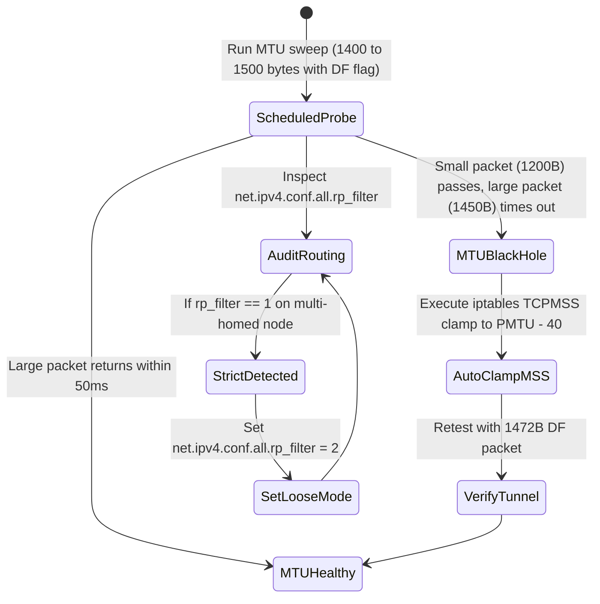

# Task 041 — Hybrid WAN, Site-to-Site VPN MTU Black Hole & BGP Routing Watchdog
# Checkpoint: 2026-10-12T10:48:00+07:00

> **Severity**: P1 (Hybrid Cloud Networking, Latency SLA & Tunnel Reliability)  
> **Target Agent**: `devops` / `backend-coder`  
> **Workspace**: Git Worktree Isolated (`Workspace: "branch"`)  
> **Goal**: Detect and mitigate MTU black holes over WireGuard/IPSec tunnels, eliminate silent Tailscale DERP fallback latency spikes, and prevent asymmetric BGP packet drop via automatic `rp_filter` tuning.

---

## 1. ROOT CAUSE ANALYSIS (RCA) & EVIDENCE

### 1.1 WireGuard/IPSec MTU Black Hole
* **Physical & Tunnel Disparity**:
  - Eth0 MTU: 1500 bytes.
  - WireGuard Outer Header: 80 bytes -> Inner MTU: 1420 bytes.
  - Client sends 1500-byte packet with `DF=1`. Intermediate switch drops packet and sends ICMP Type 3 Code 4.
  - Cloud firewall blocks inbound ICMP.
* **Symptom**: Ping and curl headers work (small frames), but large API response, TLS handshake, or file upload hangs indefinitely.

### 1.2 Silent DERP Relay Fallback
* **Tunnel Degradation**: Direct UDP fails due to NAT churn; tunnel silently routes through distant relay server (e.g. Frankfurt -> Singapore -> Frankfurt), jumping latency from 5ms to 180ms.

---

## 2. GO STRUCTS & INTERFACE CONTRACTS

```go
package netguard

import (
	"context"
	"time"
)

type TunnelTransportMode string

const (
	TransportP2PDirect TunnelTransportMode = "direct_udp"
	TransportDERPRelay TunnelTransportMode = "relay_fallback"
)

type HybridTunnelStatus struct {
	InterfaceName   string              `json:"interface_name"`
	TunnelType      string              `json:"tunnel_type"`       // "wireguard", "ipsec", "tailscale"
	TransportMode   TunnelTransportMode `json:"transport_mode"`
	ConfiguredMTU   int                 `json:"configured_mtu"`
	DetectedPMTU    int                 `json:"detected_pmtu"`     // Path MTU derived via DF sweep
	MSSClampingOn   bool                `json:"mss_clamping_on"`
	RPFilterMode    int                 `json:"rp_filter_mode"`    // 0=off, 1=strict, 2=loose
	RTTLatencyMs    float64             `json:"rtt_latency_ms"`
	PacketLossPct   float64             `json:"packet_loss_pct"`
	LastTestedAt    time.Time           `json:"last_tested_at"`
}

type TunnelWatchdog interface {
	ProbePathMTU(ctx context.Context, targetIP string) (int, error)
	AuditRPFilter(ctx context.Context) (map[string]int, error)
	EnforceMSSClamping(ctx context.Context, iface string, pmtu int) error
	CheckTransportHealth(ctx context.Context) ([]HybridTunnelStatus, error)
}
```

---

## 3. STEP-BY-STEP WORKFLOW & STATE MACHINE



---

## 4. RFC 7807 ERROR SPECIFICATIONS

```json
{
  "type": "https://k8sselfhost.local/errors/tunnel-mtu-blackhole",
  "title": "Path MTU Black Hole Detected on Hybrid Tunnel",
  "status": 502,
  "detail": "Tunnel interface 'wg0' drops packets larger than 1420 bytes with DF=1. TCP MSS Clamping is currently inactive.",
  "instance": "/network/tunnels/wg0",
  "code": "TUNNEL_MTU_BLACK_HOLE"
}
```

---

## 5. VERIFICATION TEST MATRICES

| Test ID | Scenario | Command | Expected Result |
| :--- | :--- | :--- | :--- |
| **TEST-041-1** | PMTU Sweeper with mock binary search | `go test -run TestProbePathMTU ./internal/pkg/netguard/...` | Correctly identifies PMTU = 1420 within 5 iterations |
| **TEST-041-2** | Auto-MSS Clamping rule generation | `go test -run TestEnforceMSSClamping ./internal/infrastructure/kubernetes/...` | Generates valid iptables/nftables rule targeting TCP SYN |
| **TEST-041-3** | Detect DERP relay fallback latency jump | `go test -run TestDetectDERPFallback ./internal/usecase/telemetry/...` | Dispatches P1 Alert when latency increases by > 100ms |

---

## 6. ROLLBACK PLAN & SAFETY GUARDRAILS
1. If MSS clamping changes cause drop in overall interface throughput, revert to original interface MTU.
2. In multi-homed routing, verify that setting `rp_filter = 2` does not allow spoofed private RFC1918 traffic from public interfaces.
