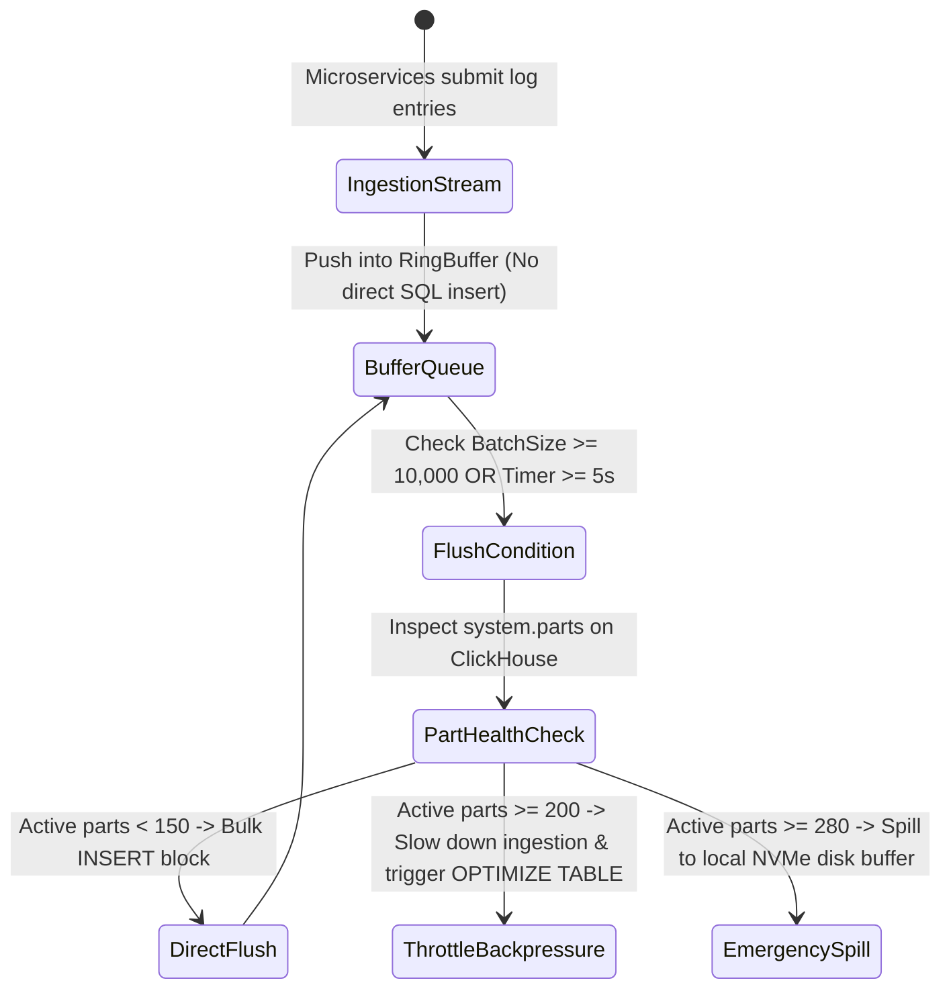

# Task 042 — ClickHouse Parts, TSDB Ingestion & OpenSearch Heap Safeguard
# Checkpoint: 2026-10-12T10:48:00+07:00

> **Severity**: P1 (Big Data Analytics, Logging Pipeline Stability & OOM Prevention)  
> **Target Agent**: `backend-coder` / `database-engineer`  
> **Workspace**: Git Worktree Isolated (`Workspace: "branch"`)  
> **Goal**: Eliminate ClickHouse `Too many parts` crashes via adaptive in-memory batch buffers, prevent TSDB out-of-order rejection for lagging edge telemetry, and guard OpenSearch/Elasticsearch from heap circuit breaker crashes.

---

## 1. ROOT CAUSE ANALYSIS (RCA) & EVIDENCE

### 1.1 ClickHouse `Too Many Parts` Explosion
* **Anti-Pattern Ingestion**:
```go
// Micro-service inserts 1 log row per HTTP request
func LogHandler(w http.ResponseWriter, r *http.Request) {
    db.Exec("INSERT INTO logs (timestamp, level, message) VALUES (?, ?, ?)", time.Now(), "INFO", "user login")
}
```
* **Consequence**: Under 1000 req/s, 1000 tiny parts created per second. Background merge thread stalls; ClickHouse returns:
  `DB::Exception: Too many parts in all data parts in table default.logs (320 > 300). Merges are processing significantly slower than inserts.`

### 1.2 OpenSearch Heap Circuit Breaker Crash
* **Unbounded Wildcard Aggregation**:
```json
{
  "aggs": {
    "all_terms": {
      "terms": { "field": "message.keyword", "size": 1000000 }
    }
  }
}
```
* **Consequence**: JVM Heap spikes to 95%, Parent Circuit Breaker trips, cluster status turns Red.

---

## 2. GO STRUCTS & INTERFACE CONTRACTS

```go
package ingestguard

import (
	"context"
	"time"
)

type BatchFlushConfig struct {
	MaxBatchSize  int           `json:"max_batch_size"`   // E.g. 10,000 records
	FlushInterval time.Duration `json:"flush_interval"`   // E.g. 5 seconds
	BufferType    string        `json:"buffer_type"`      // "ring_buffer", "channel", "kafka"
}

type ClickHouseTableHealth struct {
	Database        string    `json:"database"`
	Table           string    `json:"table"`
	ActiveParts     int       `json:"active_parts"`
	MaxPartsLimit   int       `json:"max_parts_limit"`
	MergeInProgress int       `json:"merge_in_progress"`
	HealthStatus    string    `json:"health_status"`    // "HEALTHY", "WARNING", "CRITICAL"
	LastCheckedAt   time.Time `json:"last_checked_at"`
}

type AnalyticsIngestProtector interface {
	EnqueueLog(ctx context.Context, database, table string, record any) error
	FlushPendingBatches(ctx context.Context) error
	GetTablePartHealth(ctx context.Context, table string) (*ClickHouseTableHealth, error)
	ValidateSearchQuery(queryDSL string) (bool, error)
}
```

---

## 3. STEP-BY-STEP WORKFLOW & STATE MACHINE



---

## 4. RFC 7807 ERROR SPECIFICATIONS

```json
{
  "type": "https://k8sselfhost.local/errors/clickhouse-parts-saturation",
  "title": "Analytical Table Parts Limit Near Saturation",
  "status": 503,
  "detail": "Table 'telemetry.k8s_events' has 265 active parts (threshold 300). Ingestion throttled to allow merge thread catch-up.",
  "instance": "/clickhouse/tables/telemetry/k8s_events",
  "code": "CLICKHOUSE_TOO_MANY_PARTS"
}
```

---

## 5. VERIFICATION TEST MATRICES

| Test ID | Scenario | Command | Expected Result |
| :--- | :--- | :--- | :--- |
| **TEST-042-1** | High-throughput batching test (50,000 logs) | `go test -run TestClickHouseBatchBuffer ./internal/infrastructure/clickhouse/...` | Correctly flushes in chunks of 10,000; 0 single-row inserts |
| **TEST-042-2** | Wildcard query complexity analyzer | `go test -run TestRejectUnboundedAggQuery ./internal/usecase/logging/...` | Rejects query exceeding 10s execution budget with RFC 7807 error |
| **TEST-042-3** | Concurrency verification on in-memory buffer | `go test -race -run TestIngestBufferRace ./internal/infrastructure/clickhouse/...` | Thread-safe operation under 100 concurrent producers |

---

## 6. ROLLBACK PLAN & SAFETY GUARDRAILS
1. If ClickHouse cluster is unreachable, log buffer automatically spills to compressed local Zstandard disk journal.
2. In case of OpenSearch JVM memory pressure > 85%, cancel longest-running search tasks immediately.
