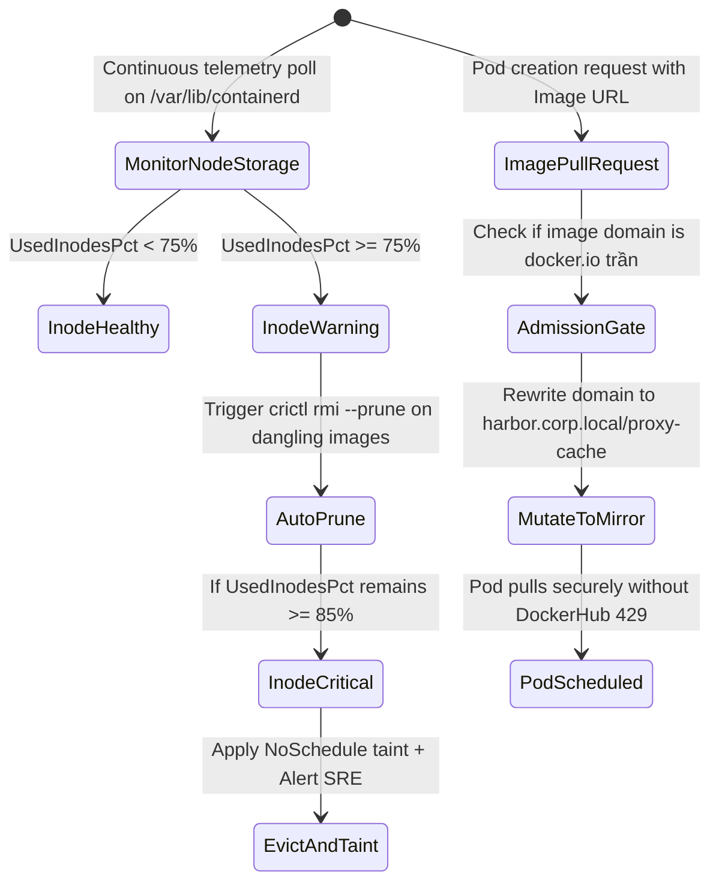

# Task 043 — Containerd Inode Depletion, Registry Rate Limit & P2P Image Resilience
# Checkpoint: 2026-10-12T10:48:00+07:00

> **Severity**: P1 (Container Runtime Reliability, Image Distribution & CI/CD)  
> **Target Agent**: `devops` / `backend-coder`  
> **Workspace**: Git Worktree Isolated (`Workspace: "branch"`)  
> **Goal**: Prevent node disk failure caused by containerd layer inode depletion, eliminate rolling update crashes from Docker Hub HTTP 429 rate limits, and resolve Spegel/Dragonfly P2P DHT routing churn loops.

---

## 1. ROOT CAUSE ANALYSIS (RCA) & EVIDENCE

### 1.1 Inode Exhaustion Despite Free Disk Space
* **Host Observation**:
  - `df -h /var/lib/containerd`: 180GB free of 500GB (36% used).
  - `df -i /var/lib/containerd`: 0 free of 32,768,000 inodes (100% used!).
* **Consequence**: Kubelet fails with `no space left on device` during `crictl pull`; Pods enter `ImagePullBackOff`.

### 1.2 Docker Hub HTTP 429 Cascading Crash
* **Deployment Event**: Auto-scaler scales from 5 to 50 pods; base image references `docker.io/library/golang:1.22-alpine`; Docker Hub returns HTTP 429; old pods terminated, new pods cannot pull; service goes down.

---

## 2. GO STRUCTS & INTERFACE CONTRACTS

```go
package runtimeguard

import (
	"context"
	"time"
)

type StorageMetricType string

const (
	MetricDiskBytes  StorageMetricType = "disk_bytes"
	MetricDiskInodes StorageMetricType = "disk_inodes"
)

type NodeStorageHealth struct {
	NodeName        string            `json:"node_name"`
	MountPoint      string            `json:"mount_point"`
	TotalBytes      uint64            `json:"total_bytes"`
	UsedBytesPct    float64           `json:"used_bytes_pct"`
	TotalInodes     uint64            `json:"total_inodes"`
	UsedInodesPct   float64           `json:"used_inodes_pct"`
	DanglingImages  int               `json:"dangling_images"`
	LastPrunedAt    time.Time         `json:"last_pruned_at"`
}

type RegistryMirrorConfig struct {
	PrimaryRegistry  string        `json:"primary_registry"`   // Harbor Private Registry
	MirrorURL        string        `json:"mirror_url"`
	FallbackTimeout  time.Duration `json:"fallback_timeout"`   // 15s
	RateLimitFloor   int           `json:"rate_limit_floor"`
}

type RuntimeResilienceManager interface {
	AuditNodeInodes(ctx context.Context) ([]NodeStorageHealth, error)
	TriggerDanglingPrune(ctx context.Context, node string) error
	ValidateImageManifest(imageURI string) (bool, error)
	ConfigureRegistryMirror(ctx context.Context, config RegistryMirrorConfig) error
}
```

---

## 3. STEP-BY-STEP WORKFLOW & STATE MACHINE



---

## 4. RFC 7807 ERROR SPECIFICATIONS

```json
{
  "type": "https://k8sselfhost.local/errors/node-inode-exhaustion",
  "title": "Container Runtime Inode Depletion Detected",
  "status": 507,
  "detail": "Worker node 'worker-gpu-02' has reached 94% inode capacity in /var/lib/containerd. Image extraction will fail.",
  "instance": "/nodes/worker-gpu-02/storage/inodes",
  "code": "CONTAINERD_INODE_SATURATION"
}
```

---

## 5. VERIFICATION TEST MATRICES

| Test ID | Scenario | Command | Expected Result |
| :--- | :--- | :--- | :--- |
| **TEST-043-1** | Inode pressure threshold trigger | `go test -run TestNodeInodeAudit ./cmd/probe/...` | Correctly flags warning at 75% and critical at 85% |
| **TEST-043-2** | Docker Hub mirror rewrite admission test | `go test -run TestMutateDockerHubImage ./internal/adapter/http/...` | Rewrites `golang:alpine` to internal Harbor mirror |
| **TEST-043-3** | Spegel P2P fast fallback under DHT churn | `go test -run TestP2PFallbackTimeout ./internal/infrastructure/kubernetes/...` | Falls back to Harbor within 15s if P2P peer fails |

---

## 6. ROLLBACK PLAN & SAFETY GUARDRAILS
1. Never prune images tagged as active or required by running daemonsets.
2. If private Harbor mirror is degraded, route image pull through authenticated Docker Hub service account.
