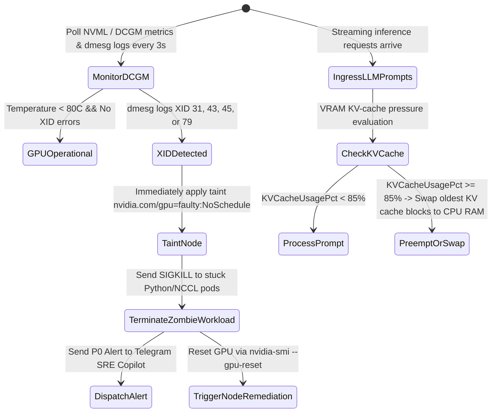

# Task 044 — GPU AI Workload Watchdog, XID Fault Eviction & KV-Cache Guard
# Checkpoint: 2026-10-12T10:48:00+07:00

> **Severity**: P1 (AI/LLM Infrastructure, GPU SRE & Cost Wastage Prevention)  
> **Target Agent**: `backend-coder` / `sre`  
> **Workspace**: Git Worktree Isolated (`Workspace: "branch"`)  
> **Goal**: Detect NVIDIA GPU XID 31/43 hardware faults to eliminate zombie training stalls, prevent vLLM/Triton CUDA OOM crashes via dynamic KV-cache pressure management, and watchdog NCCL AllReduce distributed deadlocks.

---

## 1. ROOT CAUSE ANALYSIS (RCA) & EVIDENCE

### 1.1 NVIDIA GPU XID 31 / 43 Zombie Hang
* **Kernel Event**:
  `NVRM: Xid (PCI:0000:41:00): 31, pid=14201, name=python3, Ch 00000010, MMU Fault: ENGINE GRAPHICS GPCCLIENT_T1_0`
* **Consequence**: GPU enters zombie state; Python process hangs waiting for CUDA response; NCCL ring locks up 64 nodes; 100% idle GPU cost accumulates.

### 1.2 vLLM PagedAttention KV-Cache CUDA OOM
* **Memory Burst**: Concurrent requests exceed `gpu_memory_utilization = 0.90` due to long context prompts (32K tokens). CUDA runtime crashes with `torch.cuda.OutOfMemoryError`, terminating running model inference.

---

## 2. GO STRUCTS & INTERFACE CONTRACTS

```go
package gpuwatch

import (
	"context"
	"time"
)

type GPUHealthState string

const (
	GPUHealthy   GPUHealthState = "HEALTHY"
	GPUThrottled GPUHealthState = "THERMAL_THROTTLED"
	GPUZombie    GPUHealthState = "XID_FAULT_ZOMBIE"
	GPULost      GPUHealthState = "PCI_DEVICE_LOST"
)

type GPUCardTelemetry struct {
	Index            int            `json:"index"`
	PCIAddress       string         `json:"pci_address"`
	Model            string         `json:"model"`             // E.g. "NVIDIA A100-SXM4-80GB"
	VRAMTotalBytes   uint64         `json:"vram_total_bytes"`
	VRAMUsedBytes    uint64         `json:"vram_used_bytes"`
	VRAMUsagePct     float64        `json:"vram_usage_pct"`
	KVCacheUsagePct  float64        `json:"kv_cache_usage_pct"`
	TemperatureC     int            `json:"temperature_c"`
	HealthState      GPUHealthState `json:"health_state"`
	RecentXIDErrors  []int          `json:"recent_xid_errors"`
	LastPolledAt     time.Time      `json:"last_polled_at"`
}

type GPUClusterManager interface {
	ScanNodeGPUs(ctx context.Context, node string) ([]GPUCardTelemetry, error)
	TaintFaultyGPUNode(ctx context.Context, node string, pciAddr string, xid int) error
	EvictZombiePod(ctx context.Context, podName, namespace string) error
	CheckNCCLProgress(ctx context.Context, jobID string, maxIdleDuration time.Duration) (bool, error)
}
```

---

## 3. STEP-BY-STEP WORKFLOW & STATE MACHINE



---

## 4. RFC 7807 ERROR SPECIFICATIONS

```json
{
  "type": "https://k8sselfhost.local/errors/gpu-xid-hardware-fault",
  "title": "NVIDIA GPU Hardware Fault Detected",
  "status": 500,
  "detail": "GPU 2 on node 'gpu-worker-08' reported XID 31 (MMU Fault). Node tainted and zombie pods evicted.",
  "instance": "/nodes/gpu-worker-08/gpus/2",
  "code": "GPU_XID_HARDWARE_FAULT"
}
```

---

## 5. VERIFICATION TEST MATRICES

| Test ID | Scenario | Command | Expected Result |
| :--- | :--- | :--- | :--- |
| **TEST-044-1** | Parse dmesg XID error and trigger node taint | `go test -run TestParseXIDError ./cmd/probe/...` | Correctly parses XID 31 and invokes K8s Taint API |
| **TEST-044-2** | KV-Cache Preemption Controller test | `go test -run TestKVCachePreemption ./internal/usecase/ai/...` | Triggers memory swap before VRAM hits 90% |
| **TEST-044-3** | Watchdog NCCL AllReduce hang detector | `go test -run TestNCCLProgressTimeout ./internal/usecase/sre/...` | Flags distributed training stall after 5 minutes of 0 loss delta |

---

## 6. ROLLBACK PLAN & SAFETY GUARDRAILS
1. Never evict pods on non-critical XID informational codes (e.g. XID 13, 32).
2. If GPU reset fails via software, cordon node and request hardware technician inspection via ticketing system.
