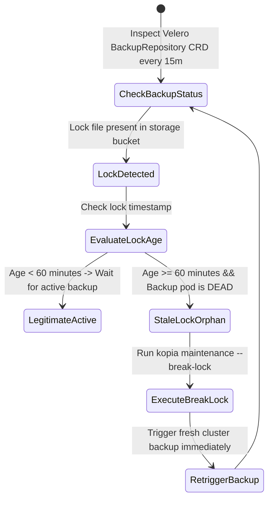

# Task 045 — Velero Snapshot Repository Lock, Air-Gapped Edge DR & KMS Guard
# Checkpoint: 2026-10-12T10:48:00+07:00

> **Severity**: P1 (Disaster Recovery, Air-Gapped Resiliency & Cryptographic Safeguards)  
> **Target Agent**: `backend-coder` / `devops`  
> **Workspace**: Git Worktree Isolated (`Workspace: "branch"`)  
> **Goal**: Automatically resolve stuck Velero/Kopia snapshot repository locks after abrupt node death, heal corrupted SQLite/Raft metadata on air-gapped edge devices, and safeguard against accidental KMS key policy deletions.

---

## 1. ROOT CAUSE ANALYSIS (RCA) & EVIDENCE

### 1.1 Stuck Snapshot Repository Lock
* **Backup Crash State**:
```bash
# Node dies during backup; lock file persists in S3/MinIO bucket
$ velero backup create daily-cluster-backup
An error occurred: repository is locked by another instance (lock created at 2026-10-10 03:00:00 UTC)
```
* **Consequence**: All subsequent scheduled backups fail silently for days until manual admin intervention.

### 1.2 Edge SQLite WAL Corruption on Power Cut
* **Dirty Storage Flush**: Consumer SSD loses DRAM cache on power cut. SQLite returns:
  `SQLITE_CORRUPT: database disk image is malformed`
* **Consequence**: Edge worker node fails to restart local control loop or report telemetry.

---

## 2. GO STRUCTS & INTERFACE CONTRACTS

```go
package drhealing

import (
	"context"
	"time"
)

type BackupStorageLockStatus struct {
	LocationName    string        `json:"location_name"`
	Provider        string        `json:"provider"`         // "minio", "s3", "gcs"
	Bucket          string        `json:"bucket"`
	IsLocked        bool          `json:"is_locked"`
	LockCreatedBy   string        `json:"lock_created_by"`
	LockAge         time.Duration `json:"lock_age"`
	IsStale         bool          `json:"is_stale"`         // Age > 60m with no active process
	LastCheckedAt   time.Time     `json:"last_checked_at"`
}

type EdgeDatabaseIntegrity struct {
	NodeID          string    `json:"node_id"`
	DBPath          string    `json:"db_path"`
	JournalMode     string    `json:"journal_mode"`
	Synchronous     string    `json:"synchronous"`
	IsCorrupt       bool      `json:"is_corrupt"`
	IntegrityCheck  string    `json:"integrity_check"`  // "ok" or error string
	LastVerifiedAt  time.Time `json:"last_verified_at"`
}

type DRResilienceManager interface {
	InspectBackupLocks(ctx context.Context) ([]BackupStorageLockStatus, error)
	BreakStaleLock(ctx context.Context, locationName string) error
	RepairEdgeDatabase(ctx context.Context, nodeID, dbPath string) error
	AuditKMSKeyProtection(ctx context.Context, keyARN string) (bool, error)
}
```

---

## 3. STEP-BY-STEP WORKFLOW & STATE MACHINE



---

## 4. RFC 7807 ERROR SPECIFICATIONS

```json
{
  "type": "https://k8sselfhost.local/errors/backup-repository-stale-lock",
  "title": "Stale Backup Repository Lock Auto-Cleared",
  "status": 200,
  "detail": "Kopia repository lock was orphaned for 142 minutes after node OOM. Lock broken and backup re-queued.",
  "instance": "/backup/locations/default-s3/locks",
  "code": "STALE_BACKUP_LOCK_CLEARED"
}
```

---

## 5. VERIFICATION TEST MATRICES

| Test ID | Scenario | Command | Expected Result |
| :--- | :--- | :--- | :--- |
| **TEST-045-1** | Detect stale lock > 60m and break lock | `go test -run TestBreakStaleBackupLock ./internal/infrastructure/backup/...` | Breaks lock cleanly without corrupting snapshot metadata |
| **TEST-045-2** | Edge SQLite auto-repair from WAL checkpoint | `go test -run TestRepairEdgeDatabase ./cmd/probe/...` | Rebuilds SQLite database and restores last valid checkpoint |
| **TEST-045-3** | Validate KMS Key Deletion Protection audit | `go test -run TestAuditKMSKeyProtection ./internal/infrastructure/cloud/...` | Flags un-protected KMS keys lacking multi-party quorum |

---

## 6. ROLLBACK PLAN & SAFETY GUARDRAILS
1. Never execute `break-lock` if the backup controller pod is confirmed running on a healthy node.
2. In edge SQLite repair, always preserve `.corrupt` snapshot copy on local disk before applying in-place recovery.
