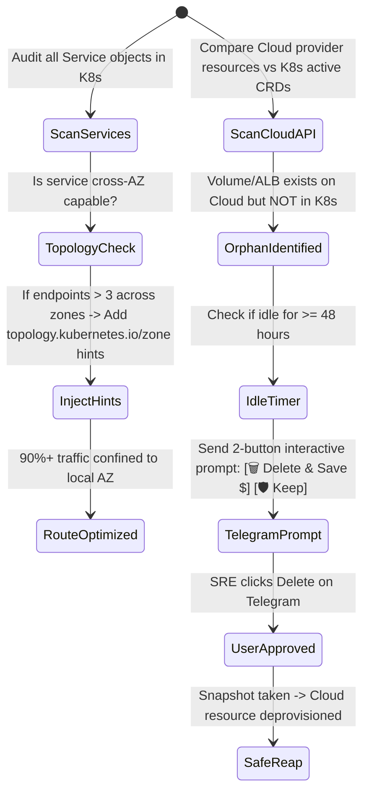

# Task 046 — FinOps Cross-AZ Egress Optimizer & Cloud Orphan Resource Reaper
# Checkpoint: 2026-10-12T10:48:00+07:00

> **Severity**: P1 (FinOps, Cost Anomaly Control & Cloud Waste Elimination)  
> **Target Agent**: `backend-coder` / `database-engineer`  
> **Workspace**: Git Worktree Isolated (`Workspace: "branch"`)  
> **Goal**: Prevent tens of thousands in unexpected cross-AZ network egress bills via automated `topologyAwareHints` injection, and eliminate zombie cloud resources (unattached EBS volumes, orphan ELBs/ALBs, idle Elastic IPs) after namespace deletion.

---

## 1. ROOT CAUSE ANALYSIS (RCA) & EVIDENCE

### 1.1 Cross-AZ Egress Cost Explosion
* **Default K8s Service Behavior**:
```yaml
apiVersion: v1
kind: Service
metadata:
  name: order-service
spec:
  # Missing topology annotations!
  # Traffic distributes 33% AZ-1, 33% AZ-2, 33% AZ-3 randomly.
  # 66% of all traffic crosses AZ boundaries -> $0.01/GB transfer tax!
```
* **Consequence**: High-throughput microservice generates 2.5 Petabytes/month of cross-AZ traffic, resulting in a $25,000 cloud billing surprise.

### 1.2 Zombie Cloud Resource Accrual
* **Orphaned Infrastructure**:
  - `kubectl delete ns test-staging` succeeds in K8s.
  - Finalizer on LoadBalancer drops silently. AWS ALB remains active, billing $0.0225/hr + LCU charges indefinitely.
  - 20x 500GB gp3 PVC volumes detached but never deleted on AWS EBS ($1,600/month wasted).

---

## 2. GO STRUCTS & INTERFACE CONTRACTS

```go
package finopsguard

import (
	"context"
	"time"
)

type CloudResourceType string

const (
	ResourceEBSVolume    CloudResourceType = "ebs_volume"
	ResourceLoadBalancer CloudResourceType = "load_balancer"
	ResourceElasticIP    CloudResourceType = "elastic_ip"
	ResourceNATGateway   CloudResourceType = "nat_gateway"
)

type OrphanCloudResource struct {
	ResourceID          string            `json:"resource_id"`
	Type                CloudResourceType `json:"type"`
	CloudProvider       string            `json:"cloud_provider"`   // "aws", "gcp", "azure"
	ClusterTag          string            `json:"cluster_tag"`
	OriginalNamespace   string            `json:"original_namespace"`
	IdleSince           time.Time         `json:"idle_since"`
	EstimatedMonthlyCostUSD float64       `json:"estimated_monthly_cost_usd"`
	ApprovalStatus      string            `json:"approval_status"`  // "PENDING_TELEGRAM", "APPROVED", "RETAINED"
}

type FinOpsAutomationEngine interface {
	AuditTopologyHints(ctx context.Context) (unhintedServicesCount int, err error)
	InjectTopologyAwareHints(ctx context.Context, namespace, serviceName string) error
	ScanOrphanCloudResources(ctx context.Context) ([]OrphanCloudResource, error)
	ReapApprovedResource(ctx context.Context, resourceID string) error
	DispatchTelegramCostReport(ctx context.Context, orphans []OrphanCloudResource) error
}
```

---

## 3. STEP-BY-STEP WORKFLOW & STATE MACHINE



---

## 4. RFC 7807 ERROR SPECIFICATIONS

```json
{
  "type": "https://k8sselfhost.local/errors/finops-cross-az-cost-anomaly",
  "title": "Cross-AZ Egress Network Spike Detected",
  "status": 409,
  "detail": "Service 'checkout-worker' generated $450 in cross-AZ transfer in the last 6 hours. Auto-injecting topologyAwareHints.",
  "instance": "/services/production/checkout-worker",
  "code": "FINOPS_CROSS_AZ_WASTE_DETECTED"
}
```

---

## 5. VERIFICATION TEST MATRICES

| Test ID | Scenario | Command | Expected Result |
| :--- | :--- | :--- | :--- |
| **TEST-046-1** | Inject topology hints on K8s Service | `go test -run TestInjectTopologyAwareHints ./internal/usecase/cost/...` | Correctly adds `service.kubernetes.io/topology-mode: Auto` annotation |
| **TEST-046-2** | Orphan cloud volume scanner against K8s API | `go test -run TestScanOrphanCloudResources ./internal/infrastructure/cloud/...` | Identifies detached volumes with missing K8s PV binding |
| **TEST-046-3** | Telegram 2-button interactive callback handler | `go test -run TestTelegramReapCallback ./internal/adapter/http/...` | Safely triggers cloud deprovisioning only upon valid HMAC callback |

---

## 6. ROLLBACK PLAN & SAFETY GUARDRAILS
1. Never reap an orphan volume without first generating an ephemeral backup snapshot.
2. If topology hints cause traffic skew (> 80% on a single pod in an AZ), automatically fall back to global round-robin.
