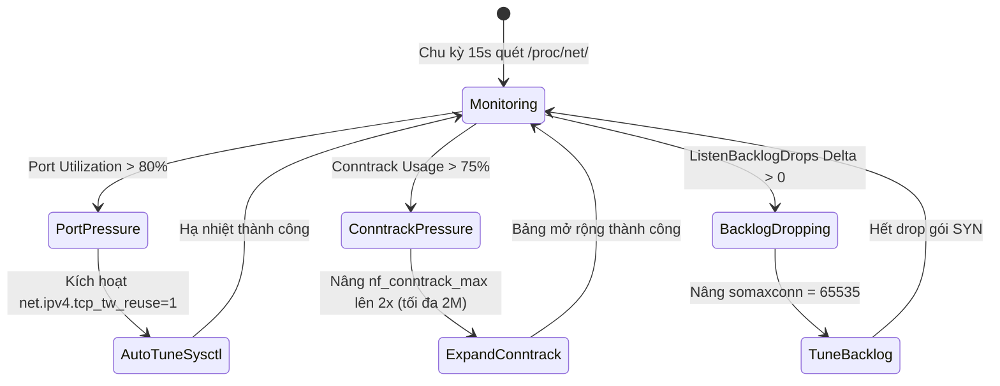

# Task 047 — Kernel Socket Backlog, TCP TIME_WAIT & Conntrack Scaler (P1)
# Checkpoint: 2026-10-12T11:45:00+07:00

> **Severity**: P1 (Kernel Networking, Socket Exhaustion & Conntrack Table Overflow)  
> **Target Agent**: `backend-coder` / `devops`  
> **Workspace**: Git Worktree Isolated (`Workspace: "branch"`)  
> **Design Rules**: Zero Packet Drop, Proactive Conntrack Expansion, Production Sysctl Guardrails  

---

## 1. PHÂN TÍCH LỖI & BẰNG CHỨNG MÃ NGUỒN (ROOT CAUSE ANALYSIS)

### Lỗi 1: Cạn Kiệt Cổng Cục Bộ (Ephemeral Port Starvation) Do Tích Tụ TCP TIME_WAIT
* **Vị trí**: Node sysctl mặc định và cấu hình Go HTTP Client không có keep-alive connection pool.
* **Cơ chế**:
  ```go
  // CODE BỊ LỖI (TẠO HTTP CLIENT KHÔNG REUSE CONNECTION):
  client := &http.Client{
      Transport: &http.Transport{
          DisableKeepAlives: true, // GÂY RA HÀNG CHỤC NGÀN TIME_WAIT SOCKETS
      },
  }
  ```
* **Căn nguyên**: Mỗi request đóng kết nối tạo ra một socket ở trạng thái `TIME_WAIT` trong 60 giây. Khi dải cổng `net.ipv4.ip_local_port_range` (32768–60999 = 28,231 ports) bị lấp đầy, mọi cuộc gọi outbound tới database hoặc API bên ngoài thất bại với `dial tcp: cannot assign requested address`.

### Lỗi 2: TCP Listen Backlog Bị Tràn (`somaxconn` & `tcp_max_syn_backlog`) Âm Thầm Drop Gói SYN
* **Vị trí**: `cmd/server/main.go` và Linux kernel defaults (`somaxconn = 128`).
* **Căn nguyên**: Khi có traffic spike, hàng đợi SYN backlog bị đầy. Kernel âm thầm vứt bỏ gói SYN mà không báo lỗi, làm client bị timeout từ 3s đến 21s do retransmission.

### Lỗi 3: Kernel Conntrack Table Saturation Đánh Sập Toàn Bộ Outbound/NAT Traffic
* **Vị trí**: `/proc/net/nf_conntrack` và sysctl `net.netfilter.nf_conntrack_max`.
* **Căn nguyên**: Hàng ngàn microservices mở kết nối UDP/DNS và HTTP ngắn hạn khiến bảng conntrack vượt ngưỡng, kernel in `nf_conntrack: table full, dropping packet` và ngắt sạch mạng node.

---

## 2. CẤU TRÚC DỮ LIỆU & INTERFACES (GO SPECIFICATION)

```go
package netscaler

import (
	"context"
	"time"
)

type SocketMetrics struct {
	TCPTimeWaitCount   int64   `json:"tcp_time_wait_count"`
	AllocatedPorts     int     `json:"allocated_ports"`
	TotalEphemeralPorts int    `json:"total_ephemeral_ports"`
	PortUtilizationPct float64 `json:"port_utilization_pct"`
	ListenBacklogDrops int64   `json:"listen_backlog_drops"`
	ConntrackEntries   int64   `json:"conntrack_entries"`
	ConntrackMax       int64   `json:"conntrack_max"`
	ConntrackUsagePct  float64 `json:"conntrack_usage_pct"`
}

type KernelNetConfig struct {
	Somaxconn            int `json:"somaxconn"`             // 65535
	TCPMaxSynBacklog     int `json:"tcp_max_syn_backlog"`   // 65535
	TCPTwReuse           int `json:"tcp_tw_reuse"`          // 1
	ConntrackMax         int `json:"conntrack_max"`         // 1048576
	ConntrackTCPTimeWait int `json:"conntrack_tcp_timeout"` // 30s
}

type SocketWatchdog interface {
	CollectMetrics(ctx context.Context) (*SocketMetrics, error)
	ApplyKernelTuning(ctx context.Context, cfg KernelNetConfig) error
	CheckHealth(ctx context.Context) error
}
```

---

## 3. LUỒNG XỬ LÝ & STATE MACHINE



---

## 4. CHUẨN HÓA MÃ LỖI (RFC 7807)

* `ERR_NET_EPHEMERAL_PORTS_EXHAUSTED`: `HTTP 503 Service Unavailable` — "Local ephemeral ports exhausted (>90% in TIME_WAIT). Outbound calls throttled."
* `ERR_NET_CONNTRACK_SATURATION`: `HTTP 500 Internal Server Error` — "Kernel conntrack table saturation detected. Risk of packet drop cascade."

---

## 5. MA TRẬN TEST CASE (VERIFICATION SUITE)

1. `TestSocketWatchdog_PortPressureDetection`: Giả lập số lượng TIME_WAIT socket chạm 85% dải port. Assert trigger trạng thái cảnh báo và đề xuất tuning.
2. `TestSocketWatchdog_ConntrackDynamicExpansion`: Giả lập bảng conntrack đạt 80% dung lượng. Assert hàm tự động áp dụng `sysctl` nâng `nf_conntrack_max`.
3. `TestHTTPClient_ConnectionPoolReusage`: Chạy 10,000 HTTP requests đồng thời qua Connection Pool. Assert số lượng TIME_WAIT sockets không vượt quá 100.

---

## 6. KẾ HOẠCH ROLLBACK & GUARDRAILS AN TOÀN

* **Guardrail**: Không bao giờ set `nf_conntrack_max` vượt quá giới hạn RAM cho phép (mỗi conntrack entry tốn ~320 bytes trong kernel memory). Giới hạn trần ở 2,097,152 entries (~670MB RAM).
* **Rollback**: Ghi lại file snapshot sysctl gốc tại `/var/run/k8s-selfhost/sysctl_backup.conf` trước khi tune. Tự động khôi phục nếu kernel báo lỗi.
