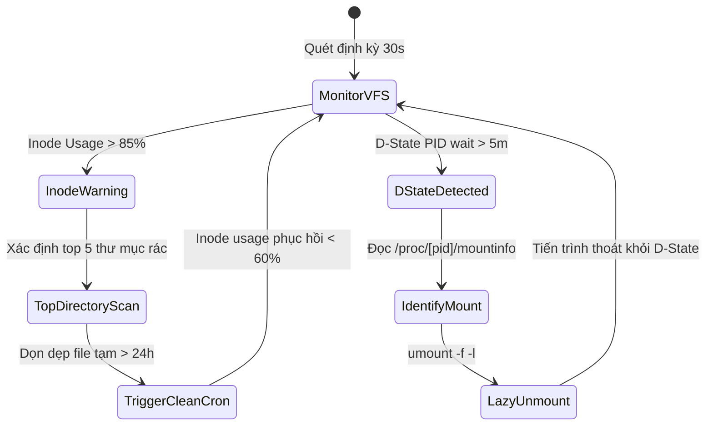

# Task 048 — VFS Inode Watchdog, D-State Process Breaker & Zombie Subreaper (P1)
# Checkpoint: 2026-10-12T11:45:00+07:00

> **Severity**: P1 (VFS Filesystem Lockups, Inode Starvation & Uninterruptible Sleep Deadlocks)  
> **Target Agent**: `backend-coder` / `devops`  
> **Workspace**: Git Worktree Isolated (`Workspace: "branch"`)  
> **Design Rules**: Non-blocking Filesystem Inspection, Clean Lazy Unmount, PID Table Protection  

---

## 1. PHÂN TÍCH LỖI & BẰNG CHỨNG MÃ NGUỒN (ROOT CAUSE ANALYSIS)

### Lỗi 1: Cạn Kiệt Inode Trong Khi Dung Lượng Đĩa Còn 90% Trống
* **Vị trí**: Các volume lưu trữ file tạm `/tmp` hoặc session files của container.
* **Cơ chế**: Ứng dụng tạo hàng triệu file rác 0-byte. Dù `df -h` báo còn trống hàng trăm GB, `df -i` đã chạm 100%. Mọi lệnh tạo file mới trả về lỗi `ENOSPC (No space left on device)`.

### Lỗi 2: Tiến Trình Kẹt Ở Trạng Thái D-State (Uninterruptible Sleep) Không Thể Kill Bằng SIGKILL
* **Vị trí**: `/proc/[pid]/status` với trạng thái `State: D (disk sleep)`.
* **Căn nguyên**: Quá trình I/O lên NFS/EFS mount bị đứt mạng hoặc đĩa chậm làm tiến trình bị treo trong kernel VFS call. Lệnh `kill -9` hoàn toàn vô dụng, ngăn cản Kubernetes dọn dẹp pod và làm pod kẹt ở `Terminating` vĩnh viễn.

### Lỗi 3: Zombie Process Fork Bomb Làm Cạn Kiệt Bảng PID (`pid_max`)
* **Cơ chế**: Container không sử dụng init subreaper (`tini`/`dumb-init`), ứng dụng làm PID 1 bỏ rơi tiến trình con chết, làm cạn kiệt `/proc/sys/kernel/pid_max`. Máy chủ không thể fork thêm bất kỳ tiến trình nào.

---

## 2. CẤU TRÚC DỮ LIỆU & INTERFACES (GO SPECIFICATION)

```go
package vfswatchdog

import (
	"context"
	"time"
)

type InodeReport struct {
	MountPoint       string   `json:"mount_point"`
	TotalInodes      uint64   `json:"total_inodes"`
	FreeInodes       uint64   `json:"free_inodes"`
	UsagePercentage  float64  `json:"usage_percentage"`
	TopCulpritDirs   []string `json:"top_culprit_dirs"`
}

type DStateProcessInfo struct {
	PID          int           `json:"pid"`
	Command      string        `json:"command"`
	WaitDuration time.Duration `json:"wait_duration"`
	WchanSymbol  string        `json:"wchan_symbol"` // ví dụ: nfs_file_write
	MountPoint   string        `json:"mount_point"`
}

type VFSWatchdog interface {
	ScanInodes(ctx context.Context) ([]InodeReport, error)
	FindTopInodeConsumers(ctx context.Context, mountPoint string, limit int) ([]string, error)
	DetectDStateProcesses(ctx context.Context, maxDuration time.Duration) ([]DStateProcessInfo, error)
	RemountOrUnmountHungNFS(ctx context.Context, mountPoint string) error
	EnforcePIDLimits(ctx context.Context, maxPIDsPerPod int) error
}
```

---

## 3. LUỒNG XỬ LÝ & STATE MACHINE



---

## 4. CHUẨN HÓA MÃ LỖI (RFC 7807)

* `ERR_VFS_INODE_EXHAUSTION`: `HTTP 507 Insufficient Storage` — "Filesystem inode utilization exceeded safe threshold (>90%)."
* `ERR_VFS_DSTATE_DEADLOCK`: `HTTP 500 Internal Server Error` — "Process stuck in Uninterruptible Sleep (D-State) on hung storage mount."

---

## 5. MA TRẬN TEST CASE (VERIFICATION SUITE)

1. `TestInodeWatchdog_CulpritDirDetection`: Tạo cây thư mục giả lập chứa 50,000 file rác nhỏ. Assert hàm định vị chính xác thư mục chứa số lượng file lớn nhất.
2. `TestDStateWatchdog_HungNFSIsolation`: Giả lập tiến trình đọc từ mock hung FIFO. Assert hàm phát hiện WCHAN và đề xuất lazy unmount.
3. `TestPIDLimiter_ZombieMitigation`: Kiểm tra enforcement của container spec đảm bảo cờ `shareProcessNamespace` hoặc init binary được inject.

---

## 6. KẾ HOẠCH ROLLBACK & GUARDRAILS AN TOÀN

* **Guardrail**: Không tự động xóa file người dùng trừ các thư mục tạm được chỉ định rõ ràng (`/tmp`, `/var/tmp`, `/cache`). Mọi thao tác dọn dẹp thư mục khác phải yêu cầu xác nhận.
* **Rollback**: Lazy unmount chỉ ngắt liên kết mountpoint hiện tại, không gây mất dữ liệu trên storage backend.
