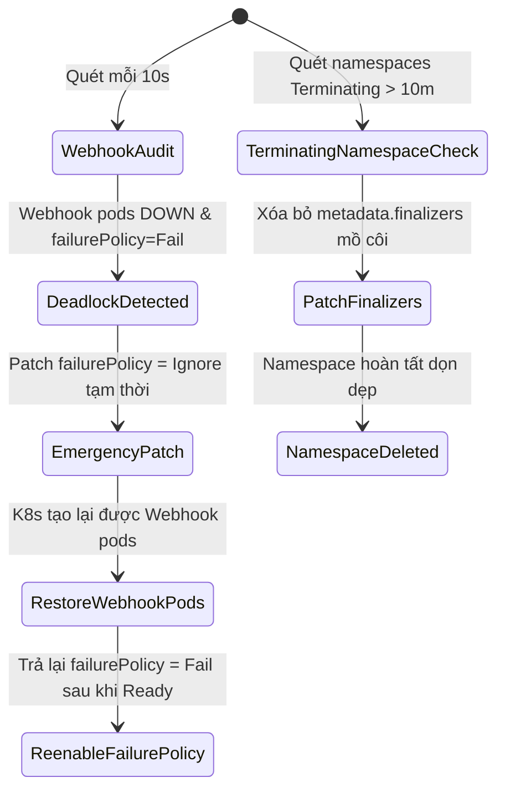

# Task 049 — K8s Webhook Deadlock Breaker, PLEG Watchdog & Finalizer Reaper (P0/P1)
# Checkpoint: 2026-10-12T11:45:00+07:00

> **Severity**: P0/P1 (Control Plane Deadlocks, Kubelet PLEG Lockups & Namespace Freeze)  
> **Target Agent**: `backend-coder` / `devops`  
> **Workspace**: Git Worktree Isolated (`Workspace: "branch"`)  
> **Design Rules**: Fail-Safe Admission Control, Emergency Webhook Bypass, Clean Finalizer Patching  

---

## 1. PHÂN TÍCH LỖI & BẰNG CHỨNG MÃ NGUỒN (ROOT CAUSE ANALYSIS)

### Lỗi 1: Mutating / Validating Webhook Timeout Deadlock Làm Đóng Băng Cụm
* **Vị trí**: `ValidatingWebhookConfiguration` hoặc `MutatingWebhookConfiguration` với `failurePolicy: Fail`.
* **Căn nguyên**: Khi webhook pod bị sập hoặc node chứa webhook chết, K8s API server cố gắng tạo pod mới nhưng lệnh tạo pod lại bị chặn bởi webhook đang chết! Cả cụm rơi vào thế deadlock, không thể tạo bất kỳ pod nào, kể cả pod webhook.

### Lỗi 2: Namespace Kẹt Ở `Terminating` Vĩnh Viễn Do Finalizer Mồ Côi
* **Cơ chế**: Namespace bị xóa nhưng chứa Custom Resource có finalizer trỏ tới CRD/APIService đã biến mất. Controller không thể dọn dẹp và kẹt vĩnh viễn.

### Lỗi 3: Kubelet PLEG (Pod Lifecycle Event Generator) Timeout Lockup
* **Cơ chế**: Containerd bị nghẽn disk I/O hoặc deadlock, lệnh CRI `ListContainers` bị treo > 3 phút. Kubelet đánh dấu node `NotReady`, dẫn tới eviction bão táp trên toàn cụm.

---

## 2. CẤU TRÚC DỮ LIỆU & INTERFACES (GO SPECIFICATION)

```go
package k8sresilience

import (
	"context"
	"time"
)

type WebhookHealthStatus struct {
	Name           string        `json:"name"`
	Type           string        `json:"type"` // mutating, validating
	FailurePolicy  string        `json:"failure_policy"`
	EndpointURL    string        `json:"endpoint_url"`
	ConsecutiveFailures int      `json:"consecutive_failures"`
	LastLatency    time.Duration `json:"last_latency"`
	IsDeadlocked   bool          `json:"is_deadlocked"`
}

type PLEGStatus struct {
	NodeName           string        `json:"node_name"`
	RelistDuration     time.Duration `json:"relist_duration"`
	IsHealthy          bool          `json:"is_healthy"`
	ContainerdResponsive bool       `json:"containerd_responsive"`
}

type ControlPlaneWatchdog interface {
	AuditWebhooks(ctx context.Context) ([]WebhookHealthStatus, error)
	EmergencyBypassDeadlockedWebhook(ctx context.Context, webhookName string) error
	ReapOrphanedFinalizers(ctx context.Context, namespace string) error
	CheckPLEGHealth(ctx context.Context, nodeName string) (*PLEGStatus, error)
	RestartStalledContainerd(ctx context.Context, nodeName string) error
}
```

---

## 3. LUỒNG XỬ LÝ & STATE MACHINE



---

## 4. CHUẨN HÓA MÃ LỖI (RFC 7807)

* `ERR_K8S_WEBHOOK_DEADLOCK`: `HTTP 500 Internal Server Error` — "Control plane deadlock detected: admission webhook is uncontactable with Fail policy."
* `ERR_K8S_PLEG_TIMEOUT`: `HTTP 504 Gateway Timeout` — "Kubelet PLEG relist duration exceeded threshold (>3m). CRI backend stalled."

---

## 5. MA TRẬN TEST CASE (VERIFICATION SUITE)

1. `TestWebhook_DeadlockBreaker`: Mock K8s API server trả về timeout khi gọi webhook endpoint. Assert hàm tự động nhận diện deadlock và phát lệnh patch `failurePolicy: Ignore`.
2. `TestFinalizerReaper_StuckNamespace`: Tạo namespace mang mock CustomResource có dummy finalizer. Assert lệnh reaper xóa sạch finalizers và namespace được xóa thành công.
3. `TestPLEG_ContainerdRestartTrigger`: Mock relist duration > 180s. Assert hệ thống gửi lệnh trigger restart containerd service an toàn.

---

## 6. KẾ HOẠCH ROLLBACK & GUARDRAILS AN TOÀN

* **Guardrail**: Chỉ tự động chuyển `failurePolicy` sang `Ignore` nếu đã có tối thiểu 5 lần thử thất bại liên tiếp và không có pod nào của webhook khả dụng.
* **Audit Trail**: Mọi thao tác gỡ bỏ finalizer hoặc bypass webhook phải ghi log audit bất biến với đầy đủ danh tính operator.
