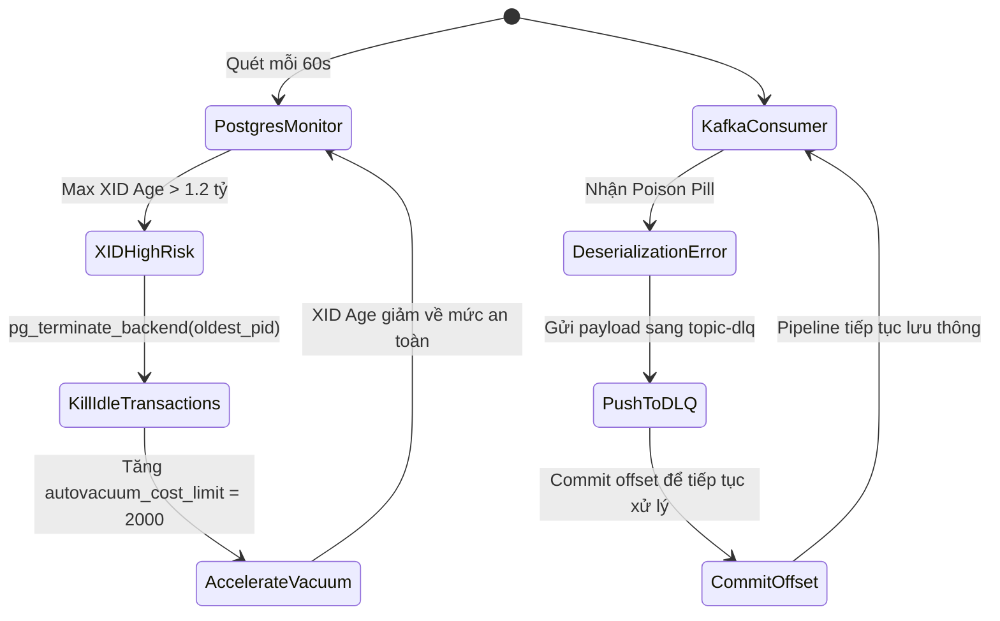

# Task 050 — Database XID Wraparound Guard, Redis Resync Storm & Kafka Poison Pill Shield (P0/P1)
# Checkpoint: 2026-10-12T11:45:00+07:00

> **Severity**: P0/P1 (Database Read-Only Lockup, Cache Replication Storms & Kafka Pipeline Blockage)  
> **Target Agent**: `backend-coder` / `database-engineer`  
> **Workspace**: Git Worktree Isolated (`Workspace: "branch"`)  
> **Design Rules**: Non-blocking Vacuum Acceleration, Replication Backlog Sizing, Automatic Dead Letter Queue  

---

## 1. PHÂN TÍCH LỖI & BẰNG CHỨNG MÃ NGUỒN (ROOT CAUSE ANALYSIS)

### Lỗi 1: PostgreSQL Transaction ID (XID) Wraparound Bắt Buộc Read-Only
* **Vị trí**: `pg_database` và truy vấn tuổi XID:
  ```sql
  SELECT datname, age(datfrozenxid) FROM pg_database;
  ```
* **Căn nguyên**: Autovacuum bị chặn bởi một transaction treo hoặc idle in transaction quá lâu. Khi tuổi transaction đạt 2 tỷ (2^31), PostgreSQL tự động shutdown và chỉ cho phép khởi động ở chế độ Single-User Read-Only để cứu vãn dữ liệu.

### Lỗi 2: Redis BGSAVE Memory Spike Gây Sập Master Node
* **Cơ chế**: Khi Redis master gọi `fork()` để ghi snapshot RDB trong lúc có tải ghi cao, Linux Copy-on-Write (CoW) đẩy mức dùng RAM lên gấp đôi, kích hoạt Linux OOM killer tiêu diệt Master.

### Lỗi 3: Redis Replica Full Resync Storm Vòng Lặp Vô Tận
* **Cơ chế**: Bộ đệm `client-output-buffer-limit replica` quá nhỏ làm ngắt kết nối replication giữa chừng, buộc Redis rơi vào chu kỳ liên tục dump RDB và ngắt kết nối làm tê liệt Master.

### Lỗi 4: Kafka Poison Pill Gây Head-of-Line Blocking Toàn Bộ Consumer Group
* **Cơ chế**: Một message bị hỏng cấu trúc khiến consumer ném ngoại lệ serialization và crash liên tục mà không commit offset, đình trệ toàn bộ pipeline.

---

## 2. CẤU TRÚC DỮ LIỆU & INTERFACES (GO SPECIFICATION)

```go
package dbsafeguard

import (
	"context"
	"time"
)

type PostgresXIDHealth struct {
	DatabaseName     string        `json:"database_name"`
	MaxXIDAge        int64         `json:"max_xid_age"`
	RemainingBeforeEmergency int64 `json:"remaining_before_emergency"`
	LongestIdleTx    time.Duration `json:"longest_idle_tx"`
	OldestTxPID      int           `json:"oldest_tx_pid"`
	IsEmergencyFreeze bool         `json:"is_emergency_freeze"`
}

type RedisReplicationHealth struct {
	MasterHost            string  `json:"master_host"`
	ConnectedReplicas     int     `json:"connected_replicas"`
	ReplBacklogSize       int64   `json:"repl_backlog_size"`
	ReplicationLagBytes   int64   `json:"replication_lag_bytes"`
	BufferOverflowCount   int64   `json:"buffer_overflow_count"`
	IsFullResyncLooping   bool    `json:"is_full_resync_looping"`
}

type KafkaPoisonPillAction struct {
	Topic           string    `json:"topic"`
	Partition       int32     `json:"partition"`
	Offset          int64     `json:"offset"`
	ErrorReason     string    `json:"error_reason"`
	RedirectedToDLQ bool      `json:"redirected_to_dlq"`
	HandledAt       time.Time `json:"handled_at"`
}

type DatabaseResilienceEngine interface {
	CheckPostgresXIDHealth(ctx context.Context) (*PostgresXIDHealth, error)
	TerminateBlockingTransactions(ctx context.Context, maxAge time.Duration) error
	TuneAutovacuumAggressiveness(ctx context.Context) error
	AuditRedisReplicationBuffer(ctx context.Context) (*RedisReplicationHealth, error)
	HandleKafkaPoisonPill(ctx context.Context, topic string, partition int32, offset int64, payload []byte, err error) error
}
```

---

## 3. LUỒNG XỬ LÝ & STATE MACHINE



---

## 4. CHUẨN HÓA MÃ LỖI (RFC 7807)

* `ERR_DB_XID_WRAPAROUND_RISK`: `HTTP 500 Internal Server Error` — "Critical: Postgres XID age approaching freeze limit. Read-only shutdown imminent."
* `ERR_KAFKA_POISON_PILL_DIVERTED`: `HTTP 422 Unprocessable Entity` — "Message deserialization failed. Diverted to Dead Letter Queue to prevent blockage."

---

## 5. MA TRẬN TEST CASE (VERIFICATION SUITE)

1. `TestPostgres_XIDWraparoundDetection`: Giả lập số liệu `age(datfrozenxid) = 1,500,000,000`. Assert hệ thống kích hoạt chế độ khẩn cấp và lệnh kill transaction nhàn rỗi.
2. `TestRedis_ResyncStormLimiter`: Giả lập replica buffer đầy liên tục. Assert engine đề xuất nâng `repl-backlog-size` và tạm ngắt replica lỗi.
3. `TestKafka_PoisonPillDLQBypass`: Gửi một JSON invalid payload vào consumer. Assert consumer bắt lỗi, chuyển message sang DLQ và commit offset mà không crash.

---

## 6. KẾ HOẠCH ROLLBACK & GUARDRAILS AN TOÀN

* **Guardrail**: Không tự động ngắt kết nối transaction đang thực thi query active trừ khi transaction ở trạng thái `idle in transaction` quá 30 phút.
* **Safety**: Message chuyển sang DLQ được lưu trữ tối thiểu 14 ngày kèm đầy đủ header nguồn để kỹ sư đối soát.
