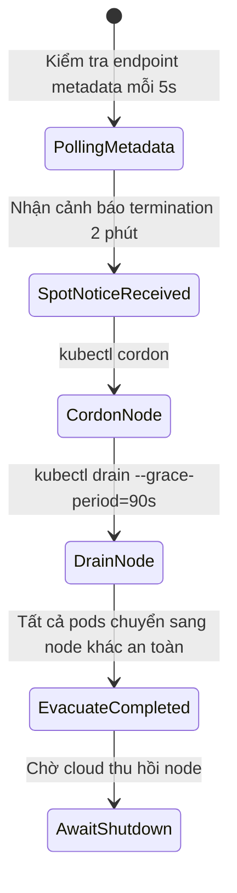

# Task 052 — Cloud Burst Credit Monitor, Spot Interruption & NAT Gateway Shield (P1)
# Checkpoint: 2026-10-12T11:45:00+07:00

> **Severity**: P1 (Storage IOPS Collapses, Spot Machine Termination & SNAT Port Drops)  
> **Target Agent**: `backend-coder` / `devops`  
> **Workspace**: Git Worktree Isolated (`Workspace: "branch"`)  
> **Design Rules**: Graceful Node Draining, Proactive Storage Upgrading, SNAT Port Elasticity  

---

## 1. PHÂN TÍCH LỖI & BẰNG CHỨNG MÃ NGUỒN (ROOT CAUSE ANALYSIS)

### Lỗi 1: AWS EBS gp2 Burst Credit Bị Cạn Kiệt Gây Đơ Ổ Đĩa Dữ Liệu
* **Căn nguyên**: Volume gp2 phụ thuộc vào Burst Balance để đạt 3000 IOPS. Khi hết credit, tốc độ rớt xuống baseline 300 IOPS, database bị nghẽn I/O hoàn toàn.
* **Giải pháp**: Tự động chuyển đổi sang volume gp3 (baseline 3000 IOPS độc lập với dung lượng) hoặc cảnh báo trước khi credit < 20%.

### Lỗi 2: Bỏ Quên Cảnh Báo Spot Termination 2 Phút Gây Đứt Giao Dịch
* **Cơ chế**: AWS gửi cảnh báo thu hồi máy chủ Spot trước 120s qua Metadata. Nếu không có daemon xử lý, máy chủ bị ngắt điện đột ngột, làm mất dữ liệu in-flight.

### Lỗi 3: Cloud NAT Gateway SNAT Port Exhaustion
* **Cơ chế**: Hàng ngàn pod gửi request ra ngoài qua 1 IP NAT Gateway (giới hạn 64,512 ports). Khi hết port, NAT Gateway âm thầm drop gói SYN gây timeout ngẫu nhiên.

---

## 2. CẤU TRÚC DỮ LIỆU & INTERFACES (GO SPECIFICATION)

```go
package cloudresilience

import (
	"context"
	"time"
)

type StorageBurstStatus struct {
	VolumeID       string  `json:"volume_id"`
	VolumeType     string  `json:"volume_type"` // gp2, gp3, io2
	BurstBalancePct float64 `json:"burst_balance_pct"`
	CurrentIOPS    int     `json:"current_iops"`
	NeedsUpgrade   bool    `json:"needs_upgrade"`
}

type SpotTerminationEvent struct {
	InstanceID   string    `json:"instance_id"`
	ActionTime   time.Time `json:"action_time"`
	DrainStarted bool      `json:"drain_started"`
	DrainSuccess bool      `json:"drain_success"`
}

type NATGatewayMetrics struct {
	GatewayID          string  `json:"gateway_id"`
	AllocatedIPs       int     `json:"allocated_ips"`
	ActiveConnections  int64   `json:"active_connections"`
	PortAllocationErrors int64 `json:"port_allocation_errors"`
	IsSaturated        bool    `json:"is_saturated"`
}

type CloudResilienceEngine interface {
	CheckEBSBurstBalance(ctx context.Context, volumeID string) (*StorageBurstStatus, error)
	UpgradeVolumeToGP3(ctx context.Context, volumeID string) error
	ListenSpotTerminationNotices(ctx context.Context, handler func(event SpotTerminationEvent)) error
	DrainNodeGracefully(ctx context.Context, nodeName string, gracePeriod time.Duration) error
	MonitorNATGatewaySNAT(ctx context.Context, gatewayID string) (*NATGatewayMetrics, error)
}
```

---

## 3. LUỒNG XỬ LÝ & STATE MACHINE



---

## 4. CHUẨN HÓA MÃ LỖI (RFC 7807)

* `ERR_CLOUD_SPOT_TERMINATION_DRAINING`: `HTTP 503 Service Unavailable` — "Node undergoing spot instance termination. Traffic drained safely."
* `ERR_CLOUD_EBS_BURST_EXHAUSTED`: `HTTP 500 Internal Server Error` — "EBS volume burst credits depleted (<20%). Immediate GP3 migration required."

---

## 5. MA TRẬN TEST CASE (VERIFICATION SUITE)

1. `TestSpotWatchdog_2MinuteDrain`: Giả lập endpoint metadata trả về `notice: terminate` sau 120s. Assert engine phát lệnh cordon và drain node trong vòng < 15 giây.
2. `TestEBS_BurstBalanceAlert`: Mock CloudWatch BurstBalance = 15%. Assert engine gắn cờ `NeedsUpgrade: true` và đề xuất chuyển sang gp3.
3. `TestNATGateway_PortAllocationOverflow`: Mock metric `ErrorPortAllocation > 0`. Assert trigger alert khẩn cấp và đề xuất thêm Elastic IP.

---

## 6. KẾ HOẠCH ROLLBACK & GUARDRAILS AN TOÀN

* **Guardrail**: Lệnh drain node bỏ qua DaemonSets và bảo đảm không làm vi phạm `PodDisruptionBudget` (PDB).
* **Automated Action**: Mọi nâng cấp volume từ gp2 lên gp3 được thực hiện online qua AWS Elastic Volumes không làm gián đoạn I/O.
